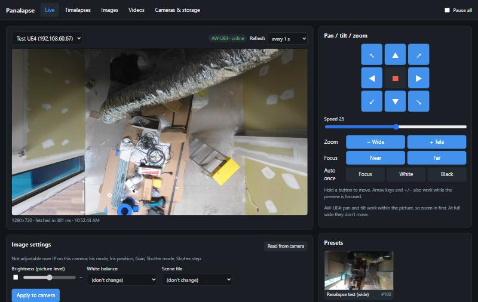

# Panalapse

Timelapse capture for Panasonic AW-series PTZ cameras, all over IP.

- Live preview with pan / tilt / zoom / focus controls, plus one-touch auto focus and white / black balance
- Presets with names and thumbnails
- Several cameras, each with a nickname, and a network scan to find them
- Scheduled timelapses (interval, times, days, date range) with auto or manual exposure
- Saves stills straight to an SMB network share (UNC path) or to `/share` / `/media`
- Turns a folder of stills into an MP4
- Image browser: look through the saved stills by day and play them back
- Home Assistant devices over MQTT (status, latest image, enable switch, capture button)
- Notifications when a timelapse starts failing

See the **Documentation** tab for setup and model notes.
